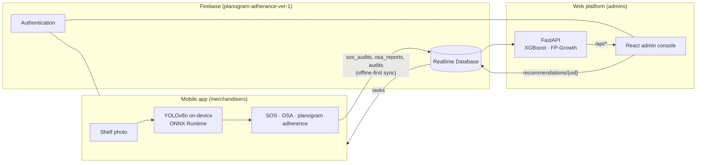

# ShelfPoa

Shelf and demand intelligence for **Flora Food Group's Blueband** range in Nairobi modern-trade outlets (Naivas, Carrefour, Quickmart, Chandarana, Cleanshelf and others).

ShelfPoa has two sides:

- **Mobile app (field):** merchandisers photograph shelves. An on-device YOLOv8 model works out Share of Shelf, On-Shelf Availability and planogram compliance, and the results sync to Firebase. It works offline.
- **Web platform (office):** a FastAPI backend serves the machine-learning outputs (XGBoost demand forecasts, FP-Growth basket rules, shelf what-ifs and new-outlet planning) to a React admin console. Admins use it to monitor outlets and merchandisers and send them tasks.

Fourth-year ICS project, Strathmore University.

---

## Repository layout

```
ShelfPoa_Web/
├── ShelfPoa_mobile/Planogram_Adherance_Mobile/   Android app (Kotlin, Jetpack Compose)
└── shelfpoa_website/
    ├── backend/                                   FastAPI ML-serving API (Python 3.10)
    └── frontend/                                  React + Vite + Tailwind admin console
```

The web side has a more detailed README at [`shelfpoa_website/README.md`](shelfpoa_website/README.md).

---

## How it fits together



- **Raw data** (outlets, audits, SOS and OSA reports, users, tasks) lives in the Firebase Realtime Database. The app and the console read and write it directly.
- **FastAPI only serves model-derived results.** It reads Firebase and the trained model files, and it never stores raw data itself.
- **Tasks loop back to the field.** The console's *Recommendation maker* writes tasks to `recommendations/{merchandiserUid}`. Each merchandiser sees only their own tasks, because the database rules check `auth.uid`, and can mark them seen or done.

---

## Mobile app

**Stack:**
- Kotlin and Jetpack Compose (Material 3), Navigation Compose
- CameraX for photos; ONNX Runtime Android 1.18 for the detector
- Room for local image storage; Firebase Auth and Realtime Database
- minSdk 26, targetSdk 34, JDK 17

**Detector:** `app/src/main/assets/best_model.onnx`, a YOLOv8n model trained on proprietary Blueband shelf images (the images aren't included).
- Input is 640×640; confidence threshold 0.35.
- Classes: the Blueband SKUs plus `OTHERS` (competitors).
- A brightness check rejects photos that are too dark before the model runs.

**What the merchandiser does:**

| Screen | What it does |
|---|---|
| Login / Sign-up | Firebase Auth. An admin turns new accounts into merchandisers. |
| Outlets | Pick the store being visited (`outlets_universe`) |
| Share of Shelf | Photo → detections → **SOS by area**: Blueband box area ÷ all detected box area. The pass mark is 20%. |
| OSA | Photo → facings per SKU across the 13-SKU range. The merchandiser confirms or corrects each SKU's availability, and corrections are recorded. |
| Planogram | Reference planogram vs. actual shelf → **adherence score**: SKUs are matched by position and order, within 20% of the frame. |
| Dashboard | The merchandiser's recent visits, SOS and OSA |
| Recommendations | Tasks sent from the web console (restock, SOS, co-promotion), with priority, due date and the model output behind them |
| Stock-outs | Open out-of-stock SKUs from recent OSA reports |

**Offline-first:** Firebase disk persistence queues every report on the phone and uploads it when there's a connection, even if the app was closed in between. If the server rejects a write, a toast says so.

**Run it:**
1. Open `ShelfPoa_mobile/Planogram_Adherance_Mobile` in Android Studio (JDK 17).
2. Download `google-services.json` from the Firebase console (Project settings → your Android app) into `app/`. It is git-ignored.
3. Run on a device. A real camera is needed for photos.

---

## Web platform

### Backend (FastAPI)

| Area | Model / method | Endpoint(s) |
|---|---|---|
| Demand forecast | XGBoost, weekly per SKU × outlet, with shelf features (SOS, OSA, planogram) and satellite catchment. Flags **rebounds after stock-outs** (last week's OSA < 75%). | `GET /api/forecast`, `POST /api/forecast/with-promo` |
| Shelf what-ifs | XGBoost counterfactual: extra units from raising SOS or planogram compliance to a target | `GET /api/shelf/opportunities?kind=sos\|planogram` |
| Basket rules | FP-Growth: what shoppers buy alongside each Blueband SKU (lift, confidence, support) | `GET /api/basket/rules` |
| New outlet planner | XGBoost model for outlets with no sales history (chain, sub-county, income, catchment) → weekly demand, opening order, facings, expected SOS and OSA | `POST /api/forecast/new-outlet`, `GET /api/forecast/new-outlet/options` |
| Map pin lookup | People within 1 km and 2 km, density and built-up growth from a pre-built Earth Engine grid | `GET /api/forecast/new-outlet/location?lat=&lon=` |
| Operations | Stock-outs, merchandiser performance, outlets, recommendations | `/api/stockouts`, `/api/merchandisers/performance`, `/api/outlets`, `/api/recommendations` |

Interactive docs are at `http://127.0.0.1:8000/docs` while the backend runs.

**Modes:** `ML_MODE=mock` returns synthetic data in the real response shapes. `ML_MODE=live` loads the models in `backend/app/ml/artifacts/`, and falls back to mock if loading fails. `/api/health` reports which mode is active.

### Frontend (React admin console)

Admin-only sign-in (Firebase Auth plus the `admin` role). There's a header search box on every page.

| Page | Purpose |
|---|---|
| Merchandiser performance | SOS, OSA, compliance and visits per merchandiser, and their submissions |
| Recommendations | Demand forecasts with week-on-week % change and rebound flags, shelf opportunities (top 8, plus a full sortable tab) and FP-Growth rules |
| Recommendation maker | Turn a model output into a task for a merchandiser |
| Stock-out alerts | Open out-of-stocks by outlet and SKU |
| New outlet planner | Pin a site on the map (or choose an existing outlet, or enter values by hand) → catchment, weekly demand, opening order, facings, expected share of shelf. Exports to CSV. |

### Run it (Windows)

```powershell
# backend
cd shelfpoa_website\backend
py -3.10 -m venv .venv
.\.venv\Scripts\activate
pip install -r requirements.txt
copy .env.example .env        # ML_MODE=live, GOOGLE_APPLICATION_CREDENTIALS, FIREBASE_DATABASE_URL
uvicorn app.main:app --reload --port 8000

# frontend (second terminal)
cd shelfpoa_website\frontend
npm install
copy .env.example .env.local  # Firebase web config + VITE_API_BASE_URL
npm run dev                   # http://localhost:5173

# give your account admin rights (once)
cd shelfpoa_website\backend
py -m scripts.make_admin you@example.com

# check every endpoint (backend running)
python smoke_test.py
```

---

## Machine-learning summary

| Component | Where it runs | Key result |
|---|---|---|
| YOLOv8n shelf detector | Phone (ONNX) | Counts SKU facings; used for SOS, OSA and planogram adherence |
| XGBoost demand model (with shelf features) | Backend | Compared against a sales-only model (`model_evaluation_shelf_vs_sales_only.csv`) |
| XGBoost new-outlet model | Backend | Held-out outlet MAPE improved from 17.2% to 14.7% after adding satellite catchment features |
| FP-Growth basket rules | Backend | Blueband → complementary-product rules for co-promotion |

**Satellite catchment** (Google Earth Engine):
- Population: WorldPop R2025A, 2026.
- Built-up growth: Open Buildings 2.5D Temporal, 2016–2023.
- The distance-weighted catchment is $e^{-0.5}\,\text{pop}_{0-1\,km} + e^{-1.5}\,\text{pop}_{1-2\,km}$.
- `backend/scripts/build_catchment_grid.py` pre-computes it every 400 m across Nairobi (10,752 points). The grid matches the per-outlet method: correlation 1.000, median ratio 0.989.

**New-outlet opening order** per SKU:

$$Q = d\cdot\frac{R+L}{7} + z\,\sigma\sqrt{\frac{R+L}{7}},\qquad \sigma=\sqrt{d+(k d)^2}$$

- d: weekly demand
- R: delivery interval in days
- L: lead time in days
- z: from the service level
- k: 1.25 × held-out MAPE

### About the data
Per-SKU, per-outlet daily sales and shelf KPIs aren't recorded at this level of detail, so the **sales, shelf-history and basket datasets are simulated**. The simulation is calibrated to the real outlet universe (75 Nairobi outlets), chain income profiles and real satellite catchments. Seeded Firebase records carry `source: "simulated"`, and every seed script can remove its own records (`--purge --yes`). The detector's training images belong to Flora Food Group and aren't in this repo.

---

## Security

- **The Firebase service-account key never goes in the repo.** Keep it outside the repo (e.g. `..\secrets\`) and point `GOOGLE_APPLICATION_CREDENTIALS` in the git-ignored `backend/.env` at it.
- `google-services.json`, `.env*` files and service-account JSON files are all git-ignored.
- **Every API route except `/api/health` needs a signed-in admin or manager.** The console sends the user's Firebase ID token; the backend verifies it and checks `users/{uid}.role` (`backend/app/core/auth.py`). No token returns 401, a wrong role 403.

## Known limitations / next steps
- Deploy: frontend to Firebase Hosting; backend to Cloud Run (Blaze plan) or a free host such as Hugging Face Spaces.
- Two legacy detector classes (`BB CHOCO 1Kg`, `BB VANILLA 250g`) aren't real products. They are filtered out of OSA and the console, but are still in the training data.
- Share of shelf for new outlets is a benchmark from comparable outlets, not a trained prediction.
- Every outlet is audited against the full 13-SKU range. Per-outlet assortments would make OSA fairer.
